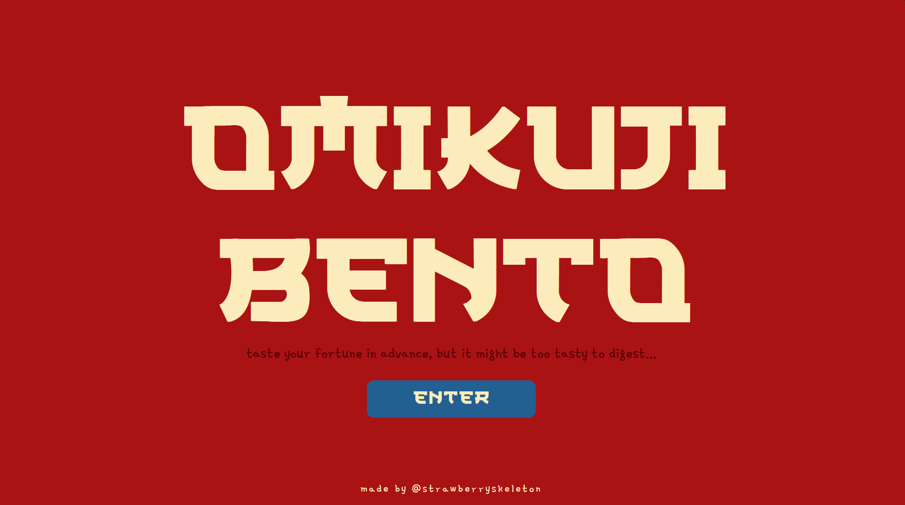
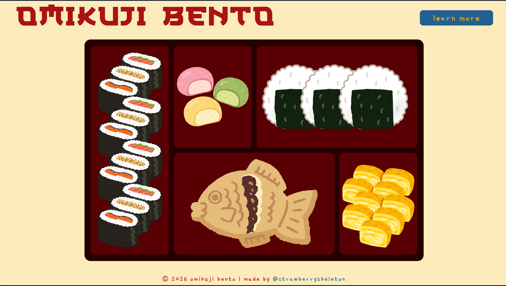
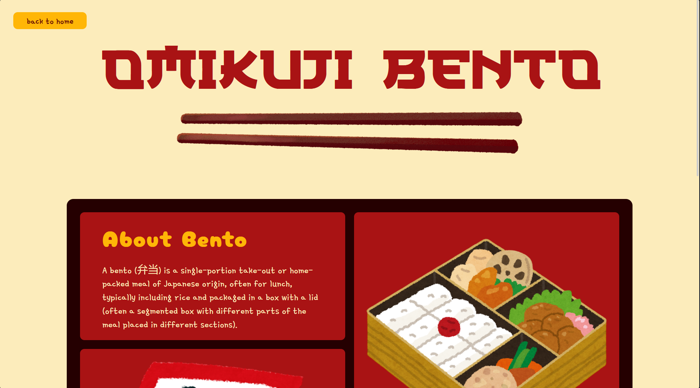

# Omikuji Bento
it's like fortune cookie, but bento!

## Features
- bento theme project
- 3 pages:
    - entry page
    - main game page
    - info page
- entry page: big logo and entryway to the main website
- main game page: has a bento box with 5 dishes. click on any dish to get your fortune scroll
- info page: bento box grid with information about bento and omikuji
- randomly picked fortunes (which technically makes it very very luck based)

## Project Screenshot

#### Entry Page

#### Bento Page

#### Info Page

## Improvement Scope
- make it responsive
- add cool animations throughout the website

## Run Locally
1. clone this repo on your device
2. open `index.html` in any browser

## Credits
- made by me
- logo font: https://www.1001fonts.com/japan-ramen-font.html
- sub-heading font: https://fonts.google.com/specimen/Cherry+Bomb+One
- body font: https://fonts.google.com/specimen/Gamja+Flower
- color palette: https://in.pinterest.com/pin/1131810950127102330/
- info: https://en.wikipedia.org/wiki/O-mikuji / https://en.wikipedia.org/wiki/Bento
- assets: canva elements